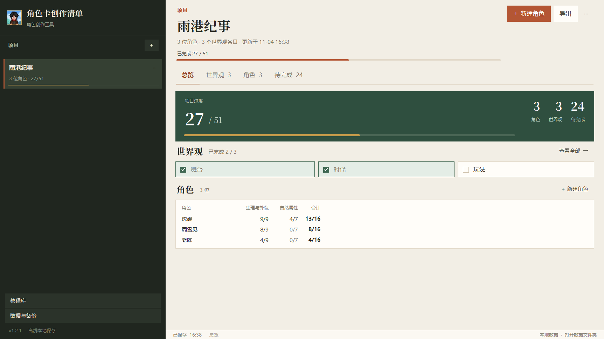
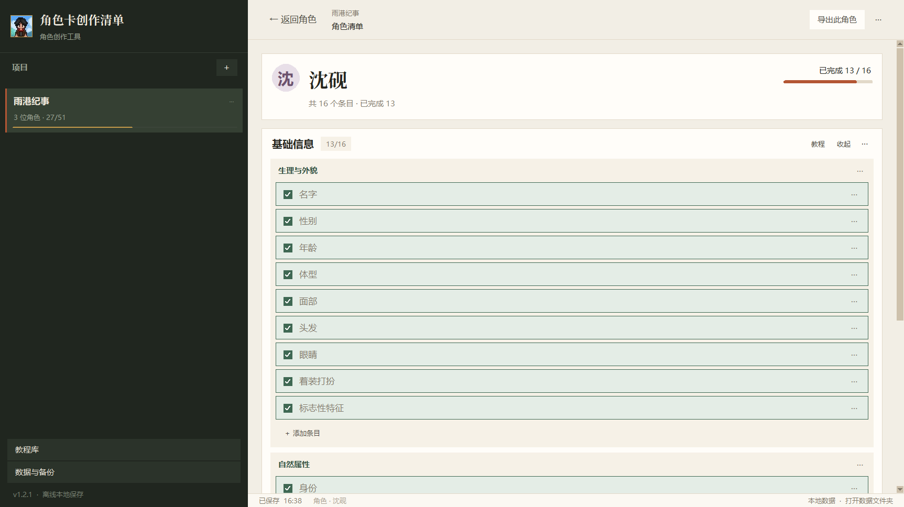
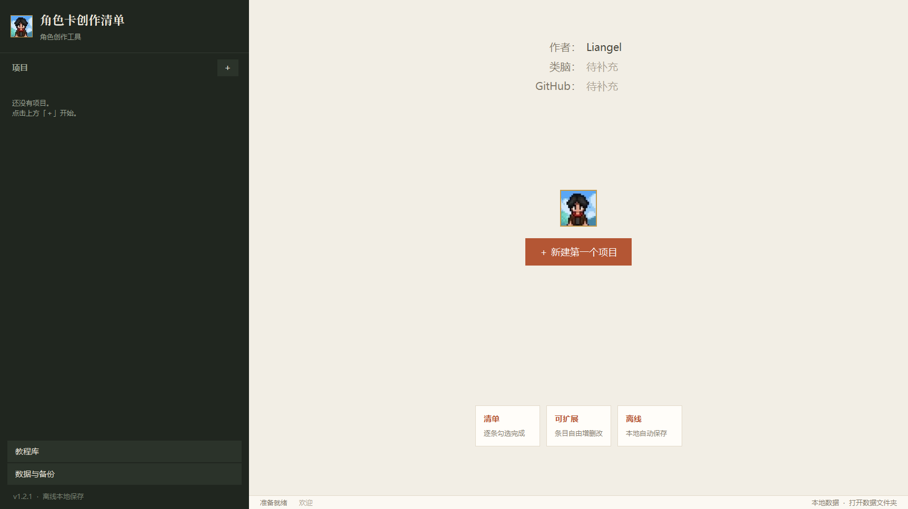

# 角色卡创作清单

> 把「人物生境写法」整理成可以逐条勾选的清单，一眼看出当前写完了多少。

一个离线、不用登录、不联网的 Windows 桌面小程序。它不做设定编辑器，只做一件事：让「这个角色写完了没有」变得一眼可见。



## 这是什么

写角色卡时，最容易卡住的不是写不出来，而是不知道还差什么。这个程序把人物生境写法拆成一条条可以勾选的清单：

- 一个项目里先写共同的世界观（舞台、时代、玩法）；
- 每个角色默认 16 个条目，分「生理与外貌」「自然属性」两组；
- 每个条目前面一个方框，点一下出现对勾即为完成；
- 总览页用大号数字、进度条和角色进度表把完成度摊开，一屏看完。



## 功能

- **总览一屏看完**：项目进度、世界观勾选、角色进度表（按分组列显示 已完成/总数），不需要滚动。
- **逐条勾选**：点方框或点条目本身都能勾；完成状态绿底 + 绿框 + 灰字。
- **完全可改**：条目、分组、世界观条目都能重命名、上移、下移、删除、新增，也可以一键补齐默认条目。
- **待完成页**：列出所有没勾的条目，点一下即完成，点条目跳到对应位置。
- **自动保存**：所有改动即时写盘，启动时自动备份。
- **导出 Markdown**：项目或单个角色都能导出成 `- [x]` / `- [ ]` 清单。



## 下载

打包好的便携版会放在 [Releases](../../releases) 里（还没发布，可先用下面的源码方式运行）。

下载后解压，双击 `角色卡创作清单.exe`。`_internal` 文件夹必须和 exe 放在一起，整个文件夹一起复制才能运行。这是未签名的本地程序，Windows 首次运行可能出现 SmartScreen 提示，点「更多信息」→「仍要运行」即可。

## 从源码运行

需要 Python 3.10+，只使用标准库 Tkinter，没有第三方依赖：

```powershell
python app.py
```

## 打包

```powershell
python -m pip install pyinstaller pillow
powershell -NoProfile -ExecutionPolicy Bypass -File .\build.ps1
```

产物在 `dist\角色卡创作清单\`。采用 onedir（便携文件夹）而不是单文件，启动更快，也不依赖系统临时目录。

## 目录结构

```text
app.py                 主程序、窗口、菜单、自动保存、项目/角色操作
store.py               数据模型、默认条目、进度、持久化、导出、旧数据迁移
views.py               总览、世界观、角色列表、待完成、角色清单
widgets.py             滚动容器、按钮、方框勾选、进度条、对话框
tutorials.py           教程库与 Markdown 阅读器
theme.py               配色、字体、ttk 样式
paths.py               开发环境 / PyInstaller 资源路径
build.ps1              一键打包脚本
build/version_info.txt Windows 文件版本信息
assets/                图标与内置教程正文
docs/                  README 截图
```

## 数据与备份

数据保存在 `%APPDATA%\角色卡创作清单\data.json`，备份在同目录的 `backups\` 里。程序内的「文件 → 打开数据文件夹」「文件 → 立即备份数据」可以直接访问。

换电脑时把整个 `角色卡创作清单` 文件夹放进新电脑的 `%APPDATA%` 即可；导出的 Markdown 也可以当纯文本备份。

程序不联网，也不收集任何内容。

## 教程来源与版权

内置教程《人物生境写法》由 **三明月** 创作，本项目只是把它作为离线阅读资料打包进来，版权归原作者所有。教程正文的使用与再分发请遵守原作者的要求；如果你只想取用程序本身，可以删除 `assets/tutorials/` 后重新打包。

## 作者

- 作者：Liangel
- GitHub：[@anqi213](https://github.com/anqi213)
- 类脑：待补充

## 许可证

本项目代码以 **CC BY-NC 4.0**（署名—非商业性使用 4.0 国际）发布：可以自由复制、修改、再分发，但需保留署名，且不得用于商业用途。详见 [LICENSE](LICENSE)。
